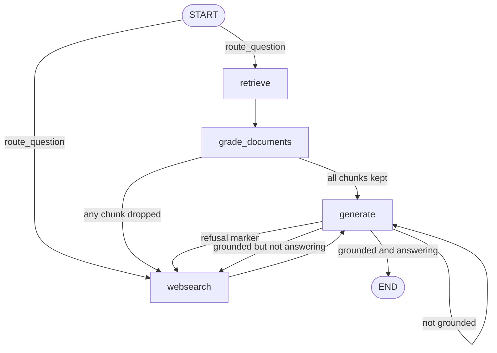

# Adaptive (Agentic) RAG with LangGraph, Ollama, Pinecone and Tavily

A question-answering graph that **chooses where to look and checks its own work**. It answers from
your own documents first (a Pinecone vector store), falls back to the web (Tavily) when the documents
are not enough, and uses small LLM "judges" to decide the route at each step.

It runs on a small local model (`qwen3:1.7b` through [Ollama](https://ollama.com/)) with local
embeddings (`embeddinggemma`), and is built with
[LangGraph](https://docs.langchain.com/oss/python/langgraph/overview).

This is a learning project. It re-builds an instructor's adaptive-RAG example in a modular, layered
structure, and documents what was learned along the way.

---

## Table of contents

1. [What it does](#what-it-does)
2. [The idea: four judges drive the routes](#the-idea-four-judges-drive-the-routes)
3. [Pipeline flow](#pipeline-flow)
4. [Project structure and layers](#project-structure-and-layers)
5. [Setup and run](#setup-and-run)
6. [File-by-file guide](#file-by-file-guide)
7. [Code reference](#code-reference)
8. [Test scripts](#test-scripts)
9. [What the runs showed](#what-the-runs-showed)
10. [Design decisions](#design-decisions)
11. [Lessons learned](#lessons-learned)
12. [Known gaps](#known-gaps)
13. [Instructor's version vs this one](#instructors-version-vs-this-one)
14. [Troubleshooting](#troubleshooting)
15. [Roadmap](#roadmap)
16. [Studying this project with an assistant](#studying-this-project-with-an-assistant)

---

## What it does

Input: a question, for example `What is agent memory?`

Output: an answer written from retrieved text, the path the graph took, the sources, and the number
of generation attempts.

```
question → route → (retrieve → grade) and/or web search → generate → check → answer
```

---

## The idea: four judges drive the routes

A plain RAG pipeline is a straight line: retrieve, then generate. This graph adds **decision
points**. At each one, a small LLM call returns a one-box verdict (a Pydantic form), and plain
Python code reads the box to pick the next node.

| # | Judge | Asks | Output | Effect |
|---|---|---|---|---|
| 1 | **Router** | Is the question about my documents? | `"vectorstore"` or `"websearch"` | Picks the entry path |
| 2 | **Retrieval grader** (once per chunk) | Is this chunk relevant? | `bool` | Drops irrelevant chunks. Any drop sets `web_search = True` |
| 3 | **Hallucination grader** | Is the answer supported by the documents? | `bool` | If not, generate again |
| 4 | **Answer grader** | Does the answer address the question? | `bool` | If not, search the web |

A fifth check is plain code, not a judge: if the generated text contains the marker `NO_ANSWER`, the
context had nothing useful, so the graph goes to the web search.

A judge returns a **route**, not content. Judging is not writing.

---

## Pipeline flow



Every failure branch has one extra exit: when `attempts >= MAX_ATTEMPTS`, the graph returns `END`.
This cap stops both loops.

### Nodes and routing functions

| Kind | Name | Does | Writes to state |
|---|---|---|---|
| Node | `retrieve` | Fetch the top-k chunks | `documents` |
| Node | `grade_documents` | Judge each chunk, keep the relevant ones | `documents`, `web_search` |
| Node | `websearch` | Search the web, **add** one document | `documents` |
| Node | `generate` | Write the answer from the documents | `generation`, `attempts` |
| Routing | `route_question` | Entry decision | nothing |
| Routing | `decide_after_grading` | Web search or generate | nothing |
| Routing | `decide_after_generation` | Marker check, then two judges | nothing |

A **node** does work and returns the keys it changed. A **routing function** only reads the state and
returns the name of the next node. It writes nothing, which is why routing functions never appear in
the stream of updates.

### State

`GraphState` is a `TypedDict` with `total=False` (every key optional). Keys without a reducer
**overwrite**, so a node that adds a document must return the old list plus the new one.

| Key | Written by | Read by |
|---|---|---|
| `question` | You, at the start | Everything |
| `documents` | `retrieve`, `grade_documents` (filtered), `websearch` (adds one) | `generate`, the hallucination check |
| `generation` | `generate` | Routing |
| `web_search` | `grade_documents` | `decide_after_grading` |
| `attempts` | `generate` (adds 1) | `decide_after_generation` (the cap) |

---

## Project structure and layers

```
09-agentic-rag/
├── main.py                  # run one question (press play)
├── ingest.py                # load, split, embed, store (press play, run once)
├── .env  .gitignore  pyproject.toml  README.md
│
├── rag/                     # one package for all library code
│   ├── __init__.py
│   ├── core/
│   │   ├── __init__.py
│   │   ├── llm.py           # ChatOllama, shared by every chain
│   │   ├── config.py        # node names, NO_ANSWER, MAX_ATTEMPTS
│   │   └── state.py         # GraphState
│   ├── data/
│   │   ├── __init__.py
│   │   ├── vectorstore.py   # embeddings, Pinecone, retriever (read side)
│   │   └── search.py        # Tavily results as one Document
│   ├── chains/
│   │   ├── __init__.py
│   │   ├── schemas.py       # RouteQuery, GradeDocuments, GradeHallucinations, GradeAnswer
│   │   ├── prompts.py       # router, graders, generation
│   │   └── chains.py        # the five chains
│   ├── nodes.py             # four nodes
│   ├── routing.py           # three routing functions
│   └── graph.py             # wiring only
│
└── checks/                  # test scripts (press play, with the path fix)
```

| Layer | Files | Job |
|---|---|---|
| Ingredients | `core/`, `data/`, `schemas.py`, `prompts.py` | Model, store, forms, instructions |
| Recipes | `chains.py` | Prompt + model + form, as callable chains |
| Stations | `nodes.py` | One graph step per function |
| Decisions | `routing.py` | Where to go next |
| Floor plan | `graph.py` | Wiring only |
| Door | `main.py`, `ingest.py` | Run it |

Imports point one way only:

```
main.py → rag.graph → (rag.nodes, rag.routing) → rag.chains.chains
        → (schemas, prompts, rag.core, rag.data)
ingest.py → rag.data.vectorstore
```

### Three rules that keep the play button working

1. Press play only on **root-level** files, or on `checks/` scripts that add the project root to
   `sys.path`. Python searches the running file's own folder, not the project root.
2. Library files import with the **full path**: `from rag.core.llm import llm`.
3. Every folder under `rag/` has an `__init__.py`.

---

## Setup and run

### Prerequisites

- Python 3.11 or newer, and [uv](https://docs.astral.sh/uv/)
- [Ollama](https://ollama.com/) running
- A [Pinecone](https://www.pinecone.io/) index with **768 dimensions** (the size of `embeddinggemma`
  vectors). Changing the embedding model means a new index and a full re-ingest.
- A [Tavily](https://tavily.com/) API key

### Install

```bash
uv add langgraph langchain-core langchain-ollama langchain-pinecone langchain-tavily \
       langchain-community langchain-text-splitters pydantic python-dotenv
ollama pull qwen3:1.7b
ollama pull embeddinggemma
```

> Use `python-dotenv`, not `dotenv`. They are different packages.

### Environment (`.env`)

```
INDEX_NAME=your-pinecone-index
PINECONE_API_KEY=your_key
TAVILY_API_KEY=your_key
```

`load_dotenv()` copies these into `os.environ`. Each library class looks up its own key by name when
the object is created, so `load_dotenv()` must run **before** the class is created.

### Fill the vector store (once)

```bash
uv run ingest.py
```

Check what the store returns before running the graph:

```bash
uv run checks/check_retriever.py
```

### Run

```bash
uv run main.py "What is agent memory?"
```

With the IDE play button no words are passed, so the default question is used.

---

## File-by-file guide

| File | Purpose | Key idea |
|---|---|---|
| `core/llm.py` | The one shared `ChatOllama` | Temperature `0` makes output repeatable |
| `core/config.py` | Node names, `NO_ANSWER`, `MAX_ATTEMPTS` | Constants stop a typo in a string from hiding |
| `core/state.py` | `GraphState` | Keys without a reducer overwrite |
| `data/vectorstore.py` | Embeddings, Pinecone, retriever | The **read** side of the store, imported by the app |
| `data/search.py` | Web search as one `Document` | Keeps each URL next to its text |
| `chains/schemas.py` | The four verdict forms | A schema is an empty labeled form. `Literal` is multiple choice, `bool` is a tick box |
| `chains/prompts.py` | Wording for each judge and the generator | Definition-style prompts beat command-style for small models |
| `chains/chains.py` | `prompt \| llm.with_structured_output(Schema)` | Read `\|` as "then". Judges return a form, generation returns text |
| `nodes.py` | The four graph steps | A node returns only the keys it changed |
| `routing.py` | The three decisions | Reads state, returns the next node name, writes nothing |
| `graph.py` | Wiring | No logic. Conditional edges map returned strings to nodes |
| `ingest.py` | Load, split, embed, store | The **write** side. Deterministic ids make a re-run overwrite |
| `main.py` | Entry point | Streams updates so every run prints its path |

---

## Code reference

The code below is the reference version. If a name differs in your files (for example
`retrieve_node`), keep your name and update the import in `graph.py`.

### `rag/core/llm.py`

```python
from langchain_ollama import ChatOllama

MODEL = "qwen3:1.7b"

llm = ChatOllama(model=MODEL, temperature=0)
```

### `rag/core/config.py`

```python
NO_ANSWER = "NO_ANSWER"

RETRIEVE = "retrieve"
GRADE_DOCUMENTS = "grade_documents"
WEBSEARCH = "websearch"
GENERATE = "generate"

MAX_ATTEMPTS = 2     # generate calls before we stop retrying
```

### `rag/core/state.py`

```python
from typing import List, TypedDict

from langchain_core.documents import Document


class GraphState(TypedDict, total=False):
    question: str
    documents: List[Document]
    generation: str
    web_search: bool     # set by grade_documents: True if any chunk was dropped
    attempts: int        # number of generate calls, to cap the retry loop
```

### `rag/chains/schemas.py`

```python
from typing import Literal

from pydantic import BaseModel, Field


class RouteQuery(BaseModel):
    """Route a user question to the most relevant data source."""

    datasource: Literal["vectorstore", "websearch"] = Field(
        description=(
            "Use 'vectorstore' for questions about LLM agents, prompt engineering "
            "and adversarial attacks on LLMs. Use 'websearch' for anything else."
        )
    )


class GradeDocuments(BaseModel):
    """Is a retrieved document relevant to the question?"""

    binary_score: bool = Field(
        description="True if the document is relevant to the question, otherwise False."
    )


class GradeHallucinations(BaseModel):
    """Is the answer grounded in the documents?"""

    binary_score: bool = Field(
        description="True if the answer is supported by the documents, otherwise False."
    )


class GradeAnswer(BaseModel):
    """Does the answer address the question?"""

    binary_score: bool = Field(
        description="True if the answer addresses the question, otherwise False."
    )
```

`binary` means two possible values. `score` is the instructor's name, and the value is `True` or
`False`, not a number.

### `rag/chains/prompts.py`

```python
from langchain_core.prompts import ChatPromptTemplate

from rag.core.config import NO_ANSWER

router_prompt = ChatPromptTemplate.from_messages([
    ("system",
     "You route user questions. Use 'vectorstore' if the question is about LLM agents "
     "(planning, memory, tools), prompt engineering, or adversarial attacks on LLMs. "
     "Use 'websearch' for everything else."),
    ("human", "{question}"),
])

retrieval_grader_prompt = ChatPromptTemplate.from_messages([
    ("system",
     "You grade whether a document is relevant to a question. Relevant means the "
     "document contains information that helps answer the question."),
    ("human", "Document:\n{document}\n\nQuestion: {question}"),
])

hallucination_grader_prompt = ChatPromptTemplate.from_messages([
    ("system",
     "You check whether an answer is supported by a set of documents. "
     "Answer True only if every claim in the answer appears in the documents. "
     "If any claim is not in the documents, answer False."),
    ("human", "Documents:\n{documents}\n\nAnswer: {generation}"),
])

answer_grader_prompt = ChatPromptTemplate.from_messages([
    ("system",
     "You grade whether an answer addresses a question. An answer addresses the "
     "question when it gives information that responds to it. 'I don't know', "
     "refusals and off-topic replies do not address the question."),
    ("human", "Question: {question}\n\nAnswer: {generation}"),
])

generation_prompt = ChatPromptTemplate.from_messages([
    ("system",
     "Answer the question using only the context, in at most three sentences. "
     "Do not add facts that are not in the context. "
     f"If the context does not contain the answer, reply with exactly {NO_ANSWER} "
     "and nothing else."),
    ("human", "Context:\n{context}\n\nQuestion: {question}"),
])
```

### `rag/chains/chains.py`

```python
from langchain_core.output_parsers import StrOutputParser

from rag.chains.prompts import (
    answer_grader_prompt, generation_prompt, hallucination_grader_prompt,
    retrieval_grader_prompt, router_prompt,
)
from rag.chains.schemas import (
    GradeAnswer, GradeDocuments, GradeHallucinations, RouteQuery,
)
from rag.core.llm import llm

question_router = router_prompt | llm.with_structured_output(RouteQuery)
retrieval_grader = retrieval_grader_prompt | llm.with_structured_output(GradeDocuments)
hallucination_grader = hallucination_grader_prompt | llm.with_structured_output(GradeHallucinations)
answer_grader = answer_grader_prompt | llm.with_structured_output(GradeAnswer)
generation_chain = generation_prompt | llm | StrOutputParser()
```

### `rag/data/vectorstore.py`

```python
import os

from dotenv import load_dotenv
load_dotenv()

from langchain_ollama import OllamaEmbeddings
from langchain_pinecone import PineconeVectorStore

embeddings = OllamaEmbeddings(model="embeddinggemma")

vector_store = PineconeVectorStore(
    index_name=os.environ["INDEX_NAME"], embedding=embeddings
)

retriever = vector_store.as_retriever(search_kwargs={"k": 5})
```

### `rag/data/search.py`

```python
from dotenv import load_dotenv
load_dotenv()   # before TavilySearch is created

from langchain_core.documents import Document
from langchain_core.tools import tool
from langchain_tavily import TavilySearch

tavily_search = TavilySearch(max_results=3)


@tool
def search_web(query: str) -> Document:
    """Search the web and return the results as one Document.

    Use for questions the local documents cannot answer. Each result in the
    text starts with its source URL.
    """
    response = tavily_search.invoke({"query": query})
    parts = [
        f'Source: {r.get("url")}\n{r.get("content", "")}'
        for r in response["results"]
        if r.get("url")
    ]
    return Document(page_content="\n\n".join(parts), metadata={"source": "web"})
```

About `@tool`: the graph's own code decides when to search, so no model ever chooses this function.
A plain function (`def search_web(query)` called as `search_web(q)`) does the same job. With
`@tool`, a docstring or a `description=` argument is required, and it is read by a model only if
the tool is bound to one. The decorator runs when the function is **defined**, so a missing
description fails at import time.

### `rag/nodes.py`

```python
from rag.chains.chains import generation_chain, retrieval_grader
from rag.core.state import GraphState
from rag.data.search import search_web
from rag.data.vectorstore import retriever


def retrieve_node(state: GraphState):
    return {"documents": retriever.invoke(state["question"])}


def grade_documents_node(state: GraphState):
    kept = []
    web_search = False
    for doc in state["documents"]:
        verdict = retrieval_grader.invoke(
            {"question": state["question"], "document": doc.page_content}
        )
        if verdict.binary_score:
            kept.append(doc)
        else:
            web_search = True          # any dropped chunk triggers a web search
    return {"documents": kept, "web_search": web_search}


def web_search_node(state: GraphState):
    doc = search_web.invoke({"query": state["question"]})
    return {"documents": state.get("documents", []) + [doc]}   # new list, not mutated


def generate_node(state: GraphState):
    context = "\n\n".join(d.page_content for d in state.get("documents", []))
    generation = generation_chain.invoke(
        {"context": context, "question": state["question"]}
    )
    return {"generation": generation, "attempts": state.get("attempts", 0) + 1}
```

Why `+ [doc]` and not `.append(doc)`: `list.append` changes the list in place and returns `None`, so
the node would return `{"documents": None}`. `old + [x]` builds a new list.

### `rag/routing.py`

```python
from langgraph.graph import END

from rag.chains.chains import answer_grader, hallucination_grader, question_router
from rag.core.config import GENERATE, MAX_ATTEMPTS, NO_ANSWER, RETRIEVE, WEBSEARCH
from rag.core.state import GraphState


def route_question(state: GraphState) -> str:
    source = question_router.invoke({"question": state["question"]})
    return WEBSEARCH if source.datasource == "websearch" else RETRIEVE


def decide_after_grading(state: GraphState) -> str:
    return WEBSEARCH if state.get("web_search", False) else GENERATE


def decide_after_generation(state: GraphState) -> str:
    generation = state["generation"]
    out_of_attempts = state["attempts"] >= MAX_ATTEMPTS

    if NO_ANSWER in generation:                    # detect with `in`, never `==`
        return END if out_of_attempts else WEBSEARCH

    context = "\n\n".join(d.page_content for d in state.get("documents", []))
    grounded = hallucination_grader.invoke(
        {"documents": context, "generation": generation}
    )
    if not grounded.binary_score:
        return END if out_of_attempts else GENERATE

    useful = answer_grader.invoke(
        {"question": state["question"], "generation": generation}
    )
    if useful.binary_score:
        return END
    return END if out_of_attempts else WEBSEARCH
```

Reading `A if condition else B`: read the middle first (the condition), then the right, then the
left. `return END if out_of_attempts else GENERATE` means "if out of attempts return `END`,
otherwise `GENERATE`".

### `rag/graph.py`

```python
from langgraph.graph import END, START, StateGraph

from rag.core.config import GENERATE, GRADE_DOCUMENTS, RETRIEVE, WEBSEARCH
from rag.core.state import GraphState
from rag.nodes import (
    generate_node, grade_documents_node, retrieve_node, web_search_node,
)
from rag.routing import (
    decide_after_generation, decide_after_grading, route_question,
)

builder = StateGraph(GraphState)

builder.add_node(RETRIEVE, retrieve_node)
builder.add_node(GRADE_DOCUMENTS, grade_documents_node)
builder.add_node(WEBSEARCH, web_search_node)
builder.add_node(GENERATE, generate_node)

builder.add_conditional_edges(
    START, route_question, {RETRIEVE: RETRIEVE, WEBSEARCH: WEBSEARCH}
)
builder.add_edge(RETRIEVE, GRADE_DOCUMENTS)
builder.add_conditional_edges(
    GRADE_DOCUMENTS, decide_after_grading, {WEBSEARCH: WEBSEARCH, GENERATE: GENERATE}
)
builder.add_edge(WEBSEARCH, GENERATE)
builder.add_conditional_edges(
    GENERATE, decide_after_generation,
    {END: END, WEBSEARCH: WEBSEARCH, GENERATE: GENERATE},
)

graph = builder.compile()
```

There is deliberately **no fixed edge from `GENERATE` to `END`**. A node with both a conditional edge
and a fixed edge gets both, which is a bug pattern seen in the instructor's version.

### `ingest.py`

```python
import hashlib

from langchain_community.document_loaders import WebBaseLoader
from langchain_text_splitters import RecursiveCharacterTextSplitter

from rag.data.vectorstore import vector_store

URLS = [
    "https://lilianweng.github.io/posts/2023-06-23-agent/",
    "https://lilianweng.github.io/posts/2023-03-15-prompt-engineering/",
    "https://lilianweng.github.io/posts/2023-10-25-adv-attack-llm/",
]

CHUNK_SIZE = 250      # characters. Tune by reading the chunks `check_retriever.py` prints
CHUNK_OVERLAP = 25
MIN_CHARS = 80        # drop tiny heading-only chunks


def load_documents(urls):
    return [doc for url in urls for doc in WebBaseLoader(url).load()]


def split_documents(docs):
    splitter = RecursiveCharacterTextSplitter(
        chunk_size=CHUNK_SIZE, chunk_overlap=CHUNK_OVERLAP
    )
    chunks = splitter.split_documents(docs)
    return [c for c in chunks if len(c.page_content) >= MIN_CHARS]


def main():
    docs = load_documents(URLS)
    chunks = split_documents(docs)
    print(f"Documents: {len(docs)}  Chunks: {len(chunks)}")

    ids = [hashlib.sha1(c.page_content.encode()).hexdigest() for c in chunks]
    vector_store.add_documents(chunks, ids=ids)   # same text, same id: overwrite
    print("Stored.")


if __name__ == "__main__":
    main()
```

`chunk_size` counts **characters** here. The instructor's `from_tiktoken_encoder(chunk_size=250)`
counts **tokens**, roughly four times larger. A splitter can also produce a chunk longer than the
limit when it has no separator to split on.

### `main.py`

```python
import sys

from rag.graph import graph

DEFAULT_QUESTION = "What is agent memory?"


def run_question(question):
    state = {"question": question}
    path = []
    for step in graph.stream(
        {"question": question},
        stream_mode="updates",
        config={"recursion_limit": 15},
    ):
        for node, update in step.items():
            path.append(node)
            state.update(update)
    return path, state


def main():
    question = " ".join(sys.argv[1:]) or DEFAULT_QUESTION
    path, state = run_question(question)

    print("QUESTION:", question)
    print("PATH    :", " -> ".join(path))
    print("\nANSWER:\n", state.get("generation"))
    print("\nSOURCES:")
    for d in state.get("documents", []):
        print(" -", d.metadata.get("source"))
    print("\nATTEMPTS:", state.get("attempts"))


if __name__ == "__main__":
    main()
```

`graph.stream(..., stream_mode="updates")` yields one dictionary per step, `{node_name: update}`.
`state.update(update)` merges each update, the way LangGraph does. `sys.argv[1:]` is the list of
words typed after the script name.

---

## Test scripts

These are scripts you run directly, not part of the app. Each tests one layer, so a failure points to
one place. Every script in `checks/` starts with a path fix:

```python
import sys
from pathlib import Path

sys.path.insert(0, str(Path(__file__).resolve().parents[1]))
```

| Script | Tests | Needs |
|---|---|---|
| `check_judge_schemas.py` | Can the model fill each form with **no prompt**? (baseline) | Ollama |
| `check_judge_chains.py` | The four judges through their chains, 8 cases | Ollama |
| `check_retrieval_isolate.py` | A 2x2: prompt wording vs class docstring | Ollama |
| `check_generation.py` | Generator, then the judges on its answer | Ollama |
| `check_refusal_marker.py` | Does the model emit `NO_ANSWER`, and where in the text? | Ollama |
| `check_retriever.py` | What the vector store returns | Pinecone, Ollama |
| `check_index_sources.py` | Which source URLs are in the index | Pinecone, Ollama |
| `check_nodes.py` | Nodes called by hand, merging updates like LangGraph | All |
| `check_grade_documents.py` | The grading loop with a fake grader, then the real one | Ollama |
| `check_routing.py` | The three routing functions on hand-made states | Ollama |
| `check_graph.py` | Diagram text and node order | All |
| `check_paths.py` | Four questions, path per question | All |
| `check_forced_paths.py` | Scripted generator replies to force refusal and retry paths | Ollama, Pinecone |
| `check_call_count.py` | Counts LLM calls per question with wrapper objects | All |
| `check_retry_repeat.py` | Does a retry give the same text? | Ollama |

Two tricks are used in several checks:

- **Swap a function for a fake** by rebinding the name inside the module that uses it
  (`nodes.retrieval_grader = FakeGrader()`), because the node looks the name up when it runs.
- **Wrap a chain in a counter object** that adds 1 to a shared dictionary and passes the call
  through. Use `counts.clear()`, not `counts = {}`, so the wrappers keep pointing at the same
  dictionary.

### How to run a prompt experiment

1. Pick one thing and write cases with expected answers. **Predict which will fail.**
2. Run, then read the misses.
3. Ask in order: is the **test** wrong, is the **prompt** wrong, or is the **model** the limit?
4. Change **one** thing and re-run. A 2x2 isolates two factors.
5. Score each judge separately. A total can hide a regression.

---

## What the runs showed

### Judges, on 8 hand-picked cases

| Version | Change | Router | Retrieval | Hallucination | Answer |
|---|---|---|---|---|---|
| v0 | no prompt | 1/2 | 1/2 | 2/2 | 1/2 |
| v1 | command-style prompts | 2/2 | **0/2** | 2/2 | 1/2 |
| v2 | definition-style for retrieval and answer | 2/2 | 2/2 | 2/2 | 2/2 |

Eight clean cases are a smoke test, not an evaluation. Later checks found judge errors the set had
hidden.

### Routing functions: 8 of 9

The miss: "Agent memory has short-term and long-term parts." was judged **not** to answer
"What is agent memory?". It may be a false negative, or the test case may be too lenient, since the
answer lists parts and does not define the term.

### Four real questions

| Question | Path |
|---|---|
| What is agent memory? | retrieve, grade_documents, websearch, generate |
| Who won the cricket world cup? | websearch, generate |
| What is chain of thought prompting? | retrieve, grade_documents, generate |
| What did the authors say about quantum computing? | retrieve, grade_documents, websearch, generate |

The web search ran in 3 of 4 paths, because one dropped chunk is enough to trigger it.

### LLM calls per question

| Path | Calls | How known |
|---|---|---|
| Retrieval, all chunks kept, first answer passes (router, 5 graders, generate, 2 judges) | **9** | Counted from code, then **measured** |
| Off-topic, first answer passes (router, generate, 2 judges) | 4 | From code |
| Cricket, one measured run | 5 | **Measured**: 2 generations and 2 grounding checks, so the cap ended the run |
| Each retry | +3 | From code |
| A refusal skips both judges | -2 | From code |

The retrieval grader runs once per chunk, so cost grows with `k`.

### Forced paths (a fake generator with scripted replies)

| Scripted replies | Path | Attempts | Final answer |
|---|---|---|---|
| `NO_ANSWER`, then a good answer | `... generate -> websearch -> generate` | 2 | The good answer |
| Invented answer, then a good one | `... generate -> generate` | 2 | The good answer |
| Invented answer every time | `... generate -> generate` | 2 | **The invented answer** |

---

## Design decisions

| Decision | Reason |
|---|---|
| Flat package with `core/`, `data/`, `chains/` | Group by what changes together. Prompt, schema and chain change together. State changes with nodes and graph |
| One shared `llm`, schemas in one file | The instructor repeated both in every chain file |
| Routing functions in `routing.py` | Decisions can be tested without building the graph. `graph.py` only wires |
| `bool` for every grader | The test showed the model fills `bool` boxes, and `if score.binary_score:` reads clearly |
| Definition-style prompts | Command-style ("Answer True only if...") inverted a relevance judge |
| `NO_ANSWER` marker, detected with `in` | Judges mishandle refusals, and the model writes the marker inside a sentence, not alone |
| Attempts cap in `decide_after_generation` | The instructor's loop has no cap of its own |
| No fixed edge from `generate` to `END` | A node with both kinds of edge runs both |
| Deterministic chunk ids | A re-ingest overwrites instead of duplicating |
| `web_search_node` returns `old + [doc]` | Keys without a reducer overwrite, and `append` returns `None` |
| `state.get("documents", [])` | The router can skip retrieval, so the key may not exist |
| Local models | No API cost. The price is weaker judging |

---

## Lessons learned

| Lesson | What happened |
|---|---|
| A schema is a form, not content | The model fills it. Field descriptions are instructions to it |
| Name the cause before changing things | Field name, docstring and prompt were tested one at a time. Only the prompt mattered |
| Command-style prompts can invert a judge | "Answer True only if..." got relevance backwards. "Relevant means..." fixed it |
| A good total can hide a regression | The total stayed at 5/8 while one judge went from 1/2 to 0/2 |
| Check the test before blaming the model | "Two parts of agent memory" assumed a premise the source may not share |
| Vector search returns the nearest chunks, even if none is relevant | That is why a retrieval grader exists |
| Most RAG failures are retrieval failures | Duplicates and heading-only chunks filled the top-k slots |
| Re-ingesting without ids duplicates everything | Use ids built from the text, and clear the index before rebuilding |
| A shared index collects leftovers | An unrelated post surfaced for "agent memory" |
| A retry only helps if something changes | Same documents, same model, temperature 0 gave identical text (`identical: True`) |
| Decide in code where you can | A string check cannot be talked out of its answer |
| `append` returns `None` | The node returned `{"documents": None}` |
| Importing runs top-level code | The instructor's `ingestion.py` scrapes on import |
| A decorator runs when the function is defined | A missing `@tool` description fails at import time, even if the function is never called |
| Read the whole output, not the score | The "good answer" miss only made sense after reading the case |

---

## Known gaps

| Gap | Detail |
|---|---|
| **Retry repeats itself** | "Generate again" sends the same documents to the same model at temperature 0, so the text is the same. It spends 2 to 3 calls for no change |
| **The cap returns an ungrounded answer** | After the last attempt, the invented answer is returned to the user |
| Answer judge false negatives | A reasonable answer was marked as not answering. Cause not yet isolated |
| Hallucination judge is lenient | Mild additions to the context sometimes pass |
| Web search fires often | One dropped chunk triggers it, so 3 of 4 test questions used it |
| Web results show as `web` in sources | The URLs are inside the text, not in the metadata |
| Stray data in the index | A post outside the three URLs was found in the index |
| Cost | About 9 LLM calls for an on-topic question |
| Judge quality | A 1.7B model is unreliable at judging, so verdicts are hints rather than proof |

---

## Instructor's version vs this one

| Area | Instructor | This project |
|---|---|---|
| Models | OpenAI (`ChatOpenAI`, `OpenAIEmbeddings`) | Local Ollama |
| Vector store | Chroma, loaded at **import time** | Pinecone, ingestion run on demand |
| Layout | `chains/` and `nodes/` folders, many small files | `core/`, `data/`, `chains/` and flat nodes, routing and graph |
| `llm` and schemas | One per chain file | One shared `llm`, one `schemas.py` |
| Grader outputs | `bool` and `"yes"/"no"` strings mixed | `bool` throughout |
| Generation prompt | Pulled from a hub | Written in `prompts.py` |
| Refusal handling | The judges | `NO_ANSWER` marker checked in code |
| Retry cap | None beyond the recursion limit | `MAX_ATTEMPTS` |
| `GENERATE` edges | Conditional edge and a fixed edge to `END` | Conditional edges only |
| Graph image | PNG drawn at import | Text diagram only |
| Chunking | Token-based | Character-based |

### Against the reflexion project (`08`)

| | `08` Reflexion | `09` Adaptive RAG |
|---|---|---|
| Starts from | The model's own knowledge | Your documents, then the web |
| Improvement comes from | Rewriting with search results | Choosing a source and checking it |
| Loop is driven by | A fixed round counter | Judge verdicts, plus a cap |
| Evidence | Web search only | Vector store, with the web as fallback |
| Model output | Free-text critique plus queries | One-box verdicts |

---

## Troubleshooting

| Symptom | Likely cause | Fix |
|---|---|---|
| `ModuleNotFoundError: rag` when pressing play | The running file's folder is searched, not the root | Press play on root-level files, or add the path fix |
| `KeyError: INDEX_NAME` | `.env` not loaded, or name wrong | Check `.env` and that `load_dotenv()` runs before creating the store |
| Retriever returns 0 chunks | Empty index, wrong index name, or wrong dimension | Run `check_retriever.py`. The index must be 768 dimensions |
| Duplicate chunks in results | Earlier ingests without ids | Clear the index, then re-ingest with `ingest.py` |
| Off-topic source in results | Leftover data in a shared index | Clear the index, or filter by source |
| `ollama ... /tokenize: EOF (status 400)` | Ollama's embedding process stopped or restarted | Retry. Check `ollama --version` and `ollama ps` |
| `TypeError: 'Document' object is not subscriptable` | Indexing a `Document` like a dictionary | Use the returned `Document` directly |
| `documents` becomes `None` | `list.append` used as a value | Return `old + [x]` |
| `ValueError: Function must have a docstring` | `@tool` with no description | Add a docstring or `description=` |
| Path ends after one `generate` with an odd answer | The cap or a judge verdict | Read the answer and check `attempts` |
| Everything goes to the web search | Chunks judged irrelevant | Print chunks and verdicts, then check chunk size and the grader prompt |
| `check_call_count.py` shows `total=0` | Wrapper not in place, or `counts = {}` used in the loop | Swap the names in the module that calls them, and use `counts.clear()` |

---

## Roadmap

- [ ] Make a retry differ from the first attempt (web search, or pass the failure back)
- [ ] Decide what a user receives at the cap instead of an ungrounded answer
- [ ] Isolate the answer judge's false negatives with a larger, more borderline case set
- [ ] Measure how often the web search fires, and test a softer rule than "any dropped chunk"
- [ ] Run the five chunk graders together with `.batch`
- [ ] Rewrite the question before searching
- [ ] Put web URLs into document metadata so sources are listed
- [ ] Try a larger model for the judges only (a separate `JUDGE_MODEL`)
- [ ] Add memory with a checkpointer and `thread_id`, so follow-up questions work

---

## Studying this project with an assistant

Name a file and ask about it. For example:

| You say | You get |
|---|---|
| "Explain `routing.py` line by line" | The three decisions, with a hand trace |
| "Test `chains.py` for me" | A small script for that layer alone |
| "Why is `search.py` a tool?" | The decision rule and the trade-offs |
| "Walk through `check_forced_paths.py`" | How a fake generator forces each branch |

Suggested reading order, bottom up:

1. `core/` (`llm.py`, `config.py`, `state.py`)
2. `chains/schemas.py`, then `prompts.py`, then `chains.py`
3. `data/vectorstore.py`, `ingest.py`, then `search.py`
4. `nodes.py`
5. `routing.py`
6. `graph.py`
7. `main.py`

Run the matching `check_*.py` after each one.

---

## License
